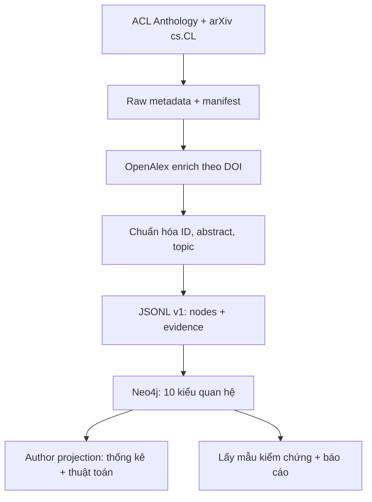

# Kiến trúc v1: mạng nhà nghiên cứu và tổ chức trong NLP/LLM

**Mục đích:** một repo Python tái hiện được việc thu thập metadata học thuật → chuẩn hóa và phân loại chủ đề từ title/abstract → dựng graph Neo4j → phân tích mạng đồng tác giả → kiểm tra chất lượng và báo cáo. Phạm vi sinh viên hai người, hoàn tất nội bộ 08/11/2026. Các số mục tiêu bên dưới là **thiết kế**, chưa phải số liệu thu được.

## 1. Một câu trả lời cụ thể của hệ thống

> “Hai tác giả A và B đã viết chung bài nào, khi viết bài đó mỗi người khai báo tổ chức nào, các bài ấy thuộc chủ đề gì, và họ nằm trong cộng đồng nghiên cứu nào?”

Neo4j phải truy ngược được từ cạnh `COAUTHORED_WITH` đến **paper ID và URL nguồn**, không chỉ vẽ hai tên cạnh nhau. Tương tự, `AFFILIATED_WITH` chỉ có nghĩa **tác giả khai báo tổ chức trong một bài cụ thể**, không có nghĩa người đó *đang* làm ở đó. `CITES` là paper X trích dẫn paper Y trong tập đã chọn, không phải Y trích dẫn X.



## 2. Phạm vi và bất biến

| Quyết định | Quy tắc làm được ngay | Lý do |
|---|---|---|
| Kho tài liệu | 2023–2025, khoảng 1.000–1.200 paper. Lấy ACL/EMNLP (main + Findings nếu thiếu số lượng) từ ACL Anthology và `cs.CL` từ arXiv. Ghi rõ tập volume/collection, ngày chốt, thứ tự chọn (ví dụ ID tăng dần và tỷ lệ theo năm) trong `configs/scope.yaml`. | Tránh chọn tùy tiện sau khi thấy kết quả. Cả ACL và arXiv đều nằm trong đề, corpus đủ nhỏ để kiểm tay. |
| Ngưỡng | Mục tiêu ≥2.000 node, ≥5.000 cạnh *duy nhất* và **10 loại quan hệ có dữ liệu thật**; đo riêng ≥1.000 Author nếu khả thi. Không đếm hai phiên bản cùng paper hai lần. | Văn bản gốc ghi “2000 nghìn”, đồng thời cho phạm vi quốc tế tối thiểu 1.000; chốt mức 2.000 bảo thủ, chờ thầy xác nhận. |
| Nguồn ưu tiên | ACL Anthology/arXiv là gốc cho metadata bài; OpenAlex bổ sung author ID, affiliation theo authorship, references. Wikipedia chỉ dùng để kiểm tra ví dụ lỗi tên tổ chức nếu cần, không ép crawl Wikipedia của mọi tác giả. | Tên đề bài gắn trực tiếp với bài ACL/arXiv; Wikipedia thiếu thông tin chi tiết đồng tác giả/citation theo bài. Nêu rõ lý do trong báo cáo theo yêu cầu “stack Wikipedia”. |
| Ngữ nghĩa “NLP” | Metadata nguồn cho biết paper trong ACL/`cs.CL`; chủ đề con từ **title + abstract**; sáu nhãn ở mục 5. Paper mơ hồ `UNKNOWN` và không tạo `HAS_TOPIC`. | Trọng tâm môn học là xử lý ngôn ngữ, không tô nhãn tùy tiện cho đủ cạnh. |
| Không suy diễn | Không dùng email domain để đoán employer, không tạo reviewer edge, không tự động hợp nhất người chỉ vì trùng tên, không nối citation nếu paper đích ngoài corpus. | Tránh quan hệ sai hoặc không có chứng cứ. |
| Định danh | Ưu tiên OpenAlex `W…` cho paper, `A…` cho author, `I…` cho institution; lưu ACL ID/arXiv ID/DOI/ROR làm alias. Paper thiếu OpenAlex dùng `acl:<id>` hoặc `arxiv:<id>`; tác giả thiếu ID ổn định chỉ gắn theo nguồn/author-index và **không** tạo cặp đồng tác giả xuyên paper nếu chưa xác thực. | Không đồng nhất tên với thực thể. DOI là khóa tra cứu; bản preprint và bản hội nghị có thể cùng một work nhưng chỉ merge khi ID/DOI chắc chắn. |

### Nguồn, hạn mức, API key

| Nguồn | Đầu vào → đầu ra cần dùng | Xác thực / lưu ý |
|---|---|---|
| [ACL Anthology API/data](https://aclanthology.org/faq/api/) | Collection/volume năm đã chốt → paper ID, title, abstract (nếu có), danh sách tác giả theo thứ tự, DOI, venue/source URL. Dùng gói `acl-anthology` hoặc XML chính thức; không scrape HTML tùy tiện. | Public. Ghi commit/tag của metadata hoặc ngày truy cập; ACL author ID dùng khi có. |
| [arXiv API](https://info.arxiv.org/help/api/user-manual.html) | `cat:cs.CL` với năm và giới hạn đã chốt → arXiv ID, title, abstract, authors, date, URL. | Public; requests có User-Agent liên hệ, retry/backoff, cache; không trông chờ đầy đủ affiliation/references ở feed. |
| [OpenAlex API](https://help.openalex.org/api/) | Tra `GET /works/doi:<DOI>` (ACL DOI hoặc DOI arXiv `10.48550/arxiv.<id>` khi có) → `id`, `authorships`, `referenced_works`, `abstract_inverted_index`, `locations`, `primary_location`. | `OPENALEX_API_KEY` miễn phí, dùng `.env` cho chạy quy mô; không commit key. OpenAlex hiện cho query nhỏ không key, nhưng cursor qua trang đầu cần key; xử lý 429 và lưu cache. [Hướng dẫn xác thực](https://help.openalex.org/api/authentication/). |
| Neo4j local | JSONL v1 → labels/relationships → Cypher queries. | `NEO4J_URI=bolt://localhost:7687`, `NEO4J_USER=neo4j`, `NEO4J_PASSWORD=<local>` trong `.env`; `7474` Browser, `7687` Bolt. Không cần Aura, GDS, Gemini, Hermes hay API LLM. |

**Lưu ý kỹ thuật DOI:** OpenAlex chấp nhận lookup theo DOI; DOI arXiv `10.48550/arxiv.<id>` có thể giúp tìm bản preprint cùng work đã xuất bản. Không tìm được thì giữ ID nguồn, ghi tỷ lệ unmatched; không fuzzy merge tự động theo title. `authors_count` lớn hoặc authorship list bị rút gọn khi list OpenAlex: dùng endpoint single-work cho các trường hợp này. `authorships[].institutions` là **tổ chức của đúng tác giả trên bài đó**, không lấy `last_known_institutions` ở author profile. `author_position=first/middle/last` chỉ là thứ tự in tên, không phải mức đóng góp hay tác giả liên hệ. [Authorships](https://help.openalex.org/data/authorships/) · [DOI lookup](https://help.openalex.org/data/works/dois/) · [Work attributes](https://help.openalex.org/data/works/attributes/).

Nếu một OpenAlex work gộp cả bản ACL và arXiv, giữ **một** Paper, ưu tiên `source_kind=acl`, `year` và `venue_id` của bản hội nghị; giữ `arxiv_id` và URL preprint làm alias/nguồn phụ trong metadata. Không tạo thêm `APPEARS_IN` tới arXiv cho paper đã có venue ACL; như vậy loại nguồn và số bài không bị đếm đôi. Nếu OpenAlex gộp nhầm hai công trình không trùng DOI/title/author, đưa vào `unresolved.csv` để rà tay trước khi import.

## 3. Kho dữ liệu và hợp đồng hai người

**A giao B** thư mục `data/processed/` theo schema bất biến. Mỗi tệp là UTF-8 JSON Lines, **1 JSON object mỗi dòng**, khóa string có namespace, null khi không biết, không tự đặt thông tin. B tự viết fixture giống hệt schema; đây là cách B xây Neo4j trước khi A crawl xong. Phiên bản contract: `schema_version: 1` trong manifest; thay đổi phải thỏa thuận trước.

| Tệp (A xuất, B tiêu thụ) | Những trường tối thiểu của mỗi hàng | Khóa duy nhất / quy tắc |
|---|---|---|
| `papers.jsonl` | `id,title,year,abstract,doi,acl_id,arxiv_id,source_kind,source_url,venue_id,openalex_id` | `id`; `source_kind=acl|arxiv`. Tên/abstract giữ bản gốc và bản chuẩn hóa chỉ để NLP; một OpenAlex work xuất hiện một lần. |
| `authors.jsonl` | `id,name,orcid,openalex_id,acl_author_id,identity_status` | `id`; `identity_status=verified|source_only|unresolved`; không dùng `name` để MERGE. |
| `institutions.jsonl` | `id,name,ror,country_code,source_url` | OpenAlex `I…`; không tạo org từ email domain; có thể để ROR null. |
| `venues.jsonl` | `id,name,kind,year,source_url` | `kind=conference|preprint_server`; `arXiv cs.CL` là preprint, không gọi hội nghị peer-reviewed. |
| `paper_authors.jsonl` | `paper_id,author_id,position,author_position,source_url` | `(paper_id,author_id)`; `position` 1-based; `author_position=first|middle|last`. Với bài 1 tác giả: `first`. |
| `affiliations.jsonl` | `paper_id,author_id,institution_id,year,raw_affiliation,source_url` | `(paper_id,author_id,institution_id)`; phải tồn tại paper/author và org; đúng authorship của paper. |
| `citations.jsonl` | `citing_paper_id,cited_paper_id,source_url` | Hai đầu trong corpus; không self-cite paper và không đảo chiều. |
| `paper_topics.jsonl` | `paper_id,topic_id,rule_id,evidence_span,confidence_band` | `(paper_id,topic_id)`; span hiện diện trong title/abstract; tối đa 2 topic/paper. `confidence_band=rule_high|reviewed`. |
| `manifest.json` | `schema_version,scope_id,created_at_utc,source_versions,input_counts,output_counts,unmatched_openalex_count,checksums` | Tệp cuối được viết sau khi xuất hoàn chỉnh; B chỉ import khi đủ file, đúng schema và checksum. |

**Ví dụ hàng cần kiểm được:**

```json
{"paper_id":"oa:W123","author_id":"oa:A456","institution_id":"oa:I789","year":2024,"raw_affiliation":"Example University","source_url":"https://openalex.org/W123"}
```

Ba ID trên chỉ là **fixture minh họa**, không phải công bố khoa học có thật. `oa:W123` và `oa:A456` chỉ hợp lệ trong fixture; dữ liệu thực cần mã nguồn trả về. Một người đổi tổ chức có thể có hai cạnh `AFFILIATED_WITH` khác năm; loader gộp theo `(author_id,institution_id)` và lưu danh sách `paper_ids,years`, không ghi `current_employer=true`.

## 4. Schema Neo4j và thuộc tính

| Label | ID và thuộc tính cần lưu | Kiểm tra |
|---|---|---|
| `Author` | `id,name,orcid,openalex_id,identity_status,source_url` | Unique `id`; rời `unresolved` không được dùng cross-paper collaboration. |
| `Paper` | `id,title,year,abstract,doi,acl_id,arxiv_id,source_kind,source_url` | Unique `id`; title nonempty, năm trong scope; alias DOI/arXiv kiểm trùng. |
| `Institution` | `id,name,ror,country_code,source_url` | Unique `id`; chỉ có bản ghi có ID đáng tin. |
| `Venue` | `id,name,kind,year,source_url` | Unique `id`; `kind` thể hiện preprint hay hội nghị. |
| `Topic` | `id,name,description,rule_version` | 6 ID cố định `llm,mt,qa,retrieval,summarization,safety_eval`. |

Mọi quan hệ lưu `source_kind` (`acl|arxiv|openalex|derived`), `source_url` hoặc `evidence_paper_ids`, `evidence_count`, `build_version`; quan hệ có nhiều paper hỗ trợ lưu `paper_ids` (tối đa số đã chọn, khoảng 1.200), `first_year,last_year`. Loader `MERGE` khóa `(from_id,type,to_id)`; với quan hệ có ngữ cảnh paper, gộp bằng danh sách ID paper **đã khử trùng**, không tạo cạnh song song chỉ vì một cặp viết nhiều bài. Báo cáo riêng **số quan hệ** và **số paper làm bằng chứng**, không cộng lẫn.

### Đúng 10 loại quan hệ, từ đơn giản tới suy diễn

| # | Type và cặp node | Điều kiện **tạo** / ý nghĩa; bằng chứng | Nhóm |
|---:|---|---|---|
| 1 | `FIRST_AUTHOR_OF` Author→Paper | `paper_authors.position=1`. Người đứng tên đầu, không khẳng định là người đóng góp nhiều nhất. | Trực tiếp |
| 2 | `OTHER_AUTHOR_OF` Author→Paper | `position>1`. Tác giả cùng bài nhưng không đứng đầu; không khẳng định “tác giả phụ” về đóng góp. | Trực tiếp |
| 3 | `COAUTHORED_WITH` Author—Author | Hai **ID khác nhau** cùng một paper; mỗi cặp vô hướng được ghi một lần theo ID sắp tăng; `paper_ids`, `shared_count`. Bài >20 tác giả đưa vào ngoại lệ rà tay trước khi sinh clique. | Suy diễn có bằng chứng |
| 4 | `AFFILIATED_WITH` Author→Institution | Có institution ID trong đúng `authorships` của paper đó; gộp paper IDs/năm trên một cặp. Không mang nghĩa quan hệ lao động hiện tại. | Trực tiếp |
| 5 | `APPEARS_IN` Paper→Venue | ACL volume/event tương ứng hoặc arXiv `cs.CL` (preprint); `Venue.kind` giúp phân biệt. | Trực tiếp |
| 6 | `HAS_TOPIC` Paper→Topic | Bộ quy tắc title/abstract ở mục 5 có span chứng cứ; tối đa 2 nhãn; null không sinh cạnh. | NLP |
| 7 | `CITES` Paper→Paper | `referenced_works` có ID paper đích trong corpus, khác chính nó; lưu URL work nguồn; citation nội bộ nên **không** nói “toàn bộ trích dẫn”. | Trực tiếp |
| 8 | `ORG_COAUTHORED_WITH` Institution—Institution | Hai tác giả trên **cùng paper** có hai affiliation ID khác nhau; một cặp tổ chức vô hướng/`paper_ids`; đây là **cùng xuất hiện ở tác giả trên bài**, không khẳng định ký hợp tác giữa hai cơ quan. | Suy diễn |
| 9 | `RESEARCHES` Author→Topic | Tác giả viết **≥2 paper khác nhau** gắn nhãn topic đó trong corpus; lưu paper IDs. Không mô tả sở trường cả đời. | Suy diễn |
| 10 | `ACTIVE_IN` Institution→Topic | Có **≥2 paper khác nhau**, mỗi paper có tác giả ghi affiliation tổ chức đó và topic ấy; lưu paper IDs. Đây là hoạt động trong **tập khảo sát**, không đánh giá toàn tổ chức. | Suy diễn |

Ba kiểu cuối **có thể ít cạnh** nếu OpenAlex thiếu affiliation. Không “bù” bằng reviewer, email hoặc cạnh đảo chiều `CITED_BY`; đo tỷ lệ nguồn thiếu, mở rộng seed paper trong phạm vi nếu cần. Đếm `COUNT(DISTINCT type(r))` và `COUNT(r)` sau import, không đếm property như một loại cạnh. Một cạnh suy diễn phải có ít nhất một paper ID hỗ trợ truy lại tới các cạnh gốc; hai kiểu topic tổng hợp cần ít nhất hai paper.

## 5. NLP tối giản nhưng kiểm chứng được

**Input:** `title + "\n" + abstract` của Paper. OpenAlex có thể trả `abstract_inverted_index`; tái dựng bằng vị trí token nếu abstract nguồn thiếu, ghi `abstract_origin`. Normalize Unicode NFKC, viết thường bản dùng cho match, chuẩn khoảng trắng; không dịch tên người, không bỏ dấu trong bản gốc. Không cần embedding, mô hình fine-tune hoặc API LLM. Từ điển rule v1 được review bằng 50 paper pilot, sửa **trước** khi lấy mẫu đánh giá, lưu version để tránh chỉnh theo đáp án.

| Topic ID | Cụm dấu hiệu trong title/abstract (ví dụ, kiểm tra ngữ cảnh) | Chặn/ưu tiên |
|---|---|---|
| `llm` | `large language model`, `instruction tuning`, `language model alignment` | Chữ `model` đơn lẻ không đủ. |
| `mt` | `machine translation`, `neural translation`, `translation quality` | `translation` trong ngữ cảnh khác cần rà. |
| `qa` | `question answering`, `reading comprehension` | `QA` đơn lẻ có thể mơ hồ. |
| `retrieval` | `retrieval-augmented generation`, `information retrieval`, `dense retrieval`, `RAG` | `rag` phải match từ nguyên vẹn, không match một phần. |
| `summarization` | `text summarization`, `document summarization`, `summarisation` | Chữ `summary` trong phần mục tiêu chung không đủ. |
| `safety_eval` | `language model safety`, `LLM evaluation`, `hallucination detection`, `red teaming` | Chỉ `evaluation` chung không đủ. |

Logic: title match được 2 điểm, abstract match được 1; yêu cầu **cụm chính xác** và tổng ≥2, ưu tiên topic có điểm cao, tối đa 2; hòa điểm thứ ba → `UNKNOWN`/đưa vào rà tay, không tự chọn ngẫu nhiên. `paper_topics.jsonl` phải ghi `rule_id` và đoạn từ chính title/abstract; đếm bài thiếu abstract, tỷ lệ `UNKNOWN`, confusion trên tập kiểm tay. Tên nhãn và luật là đề xuất có thể chỉnh qua pilot, không phải phân loại hoàn hảo. OpenAlex `primary_topic/topics` có thể dùng như **tín hiệu kiểm chéo**, không tự coi score của họ là 90% độ đúng của 6 nhãn nhóm tự đặt. [OpenAlex topics](https://help.openalex.org/data/topics/).

## 6. Từ JSONL sang graph và cách phân tích

**Thứ tự loader (B):** kiểm manifest/checksum và schema → tạo `CONSTRAINT ... REQUIRE id IS UNIQUE` cho 5 label → `UNWIND $rows` + `MERGE` node theo ID → quan hệ trực tiếp 1,2,4,5,6,7 → quan hệ suy diễn 3,8,9,10 từ JSONL/truy vấn → kiểm đếm và xuất CSV. Mỗi batch khoảng 200–500 hàng (điều chỉnh theo máy); chạy cùng input hai lần phải có số node/cạnh **giống hệt**. Nếu endpoint của quan hệ không tồn tại: ghi vào `data/rejected/edges.jsonl`, không để `MERGE` vô tình tạo node trống. `relationship_type` chỉ được chọn từ whitelist 10 tên trong code, tuyệt đối không nội suy chuỗi chưa kiểm vào Cypher.

**Truy vấn mẫu minh họa** (ID và tên lấy từ corpus sau import):

```cypher
// Đếm từng kiểu; chỉ có nghĩa sau import thật.
MATCH ()-[r]->() RETURN type(r) AS relation, count(r) AS total ORDER BY total DESC;

// Tìm bài chứng minh hai người hợp tác.
MATCH (a:Author)-[c:COAUTHORED_WITH]-(b:Author)
RETURN a.name, b.name, c.paper_ids, c.shared_count ORDER BY c.shared_count DESC LIMIT 10;

// Tìm paper trích dẫn paper khác trong corpus.
MATCH (p:Paper)-[c:CITES]->(q:Paper)
RETURN p.title, q.title, c.source_url LIMIT 10;
```

**Hai đồ thị dùng cho hai câu hỏi khác nhau:** graph nhiều label phục vụ tra cứu nguồn; mạng xã hội chiếu `Author—COAUTHORED_WITH—Author` để phân tích cấu trúc. Không dùng Venue/Topic/Institution như đường tắt khi tính số bậc xã hội. `COAUTHORED_WITH` vô hướng, export một cặp `(min_id,max_id,shared_count)`; bỏ self-loops và multi-edges. Nêu số author cô lập bị loại khỏi projection và tỷ lệ thành phần liên thông lớn nhất (LCC) trên **toàn bộ Author**.

| Phép phân tích của B | Input, output và cách giải thích |
|---|---|
| Degree / weighted degree | Số đồng tác giả khác nhau / tổng số paper viết chung. Hai khái niệm khác nhau; không gọi độ lớn org “ảnh hưởng của nhà khoa học”. |
| PageRank | `networkx.pagerank` trên author projection; nêu top 10 kèm paper cụ thể, không coi là điểm năng lực khoa học. |
| Louvain | `networkx.community.louvain_communities` trên weighted author projection, seed cố định; số cụm, modularity và ví dụ paper/nhóm chủ đề. Nếu môi trường thiếu API, dùng `greedy_modularity_communities` và ghi rõ. |
| Shortest path | Tìm đường tác giả A→B bằng các cặp đồng tác giả và liệt kê paper chứng cứ cho từng bước. “6,6” là **trung bình số cạnh trên các đường ngắn nhất của mọi cặp trong LCC**, không phải định luật sáu bậc; không tính giữa hai cụm rời nhau. |
| Small-world | Tính `C_obs` (average clustering) và `L_obs` (average shortest path) trên **LCC author-only**, so với ≥5 đồ thị ngẫu nhiên giữ **cùng dãy bậc** bằng tráo cạnh (`random_reference`/degree-preserving swap), cùng số node, ghi seed. `σ=(C_obs/C_rand)/(L_obs/L_rand)`. Chỉ nói có **dấu hiệu** small-world khi `σ>1`, C cao hơn rõ và L gần random; nếu C_rand=0/graph quá nhỏ, báo không xác định. Không suy luận từ một L thấp, không công bố p-value nếu chưa làm kiểm định. Do clique từ bài nhiều tác giả có thể làm C tăng cơ học, nêu hạn chế này. |

[NetworkX small-world reference](https://networkx.org/documentation/stable/reference/algorithms/smallworld.html) và repo Nhóm 13 `analysis_algorithm/src/small_world.py` là gợi ý; không bê nguyên số liệu/đồ thị của nhóm khác vào báo cáo.

## 7. Chất lượng 90%: phép đo có thể bảo vệ trước thầy

**Không thể chứng minh độ chính xác bằng cách đếm số cạnh.** Chất lượng cạnh đo bằng **precision** = cạnh đúng / cạnh được kiểm; nếu muốn dùng từ “accuracy”, phải có thêm mẫu *không có cạnh* và định nghĩa TP/FP/TN/FN. Tách chất lượng **ID/nút**, **relation**, **topic classification** và **coverage**.

1. B cố định seed (`20261107`) và rút ngẫu nhiên **20 cạnh mỗi type** (10 loại = 200; nếu type <20 thì kiểm hết), tránh chỉ chọn ví dụ đẹp; xuất `evaluation/samples.csv` gồm source/target/type/evidence URL, không có nhãn dự đoán giấu người gán. A và B cùng gán **50 mẫu chồng** ở ngày 07–08/11, phần còn lại phân đôi. Tranh cãi rà nguồn gốc và ghi quyết định trong `adjudication.csv`.
2. `correct=1` nếu hai đầu node đúng thực thể, hướng/type đúng, paper/topic/affiliation thực sự được nguồn hỗ trợ, ngưỡng suy diễn đúng. `correct=0` nếu sai bất kỳ điều nào; `unverifiable` không tự động tính đúng, báo riêng và tính là sai trong chỉ số bảo thủ. Lưu `error_reason` (identity, affiliation, topic, citation, missing source, derivation).
3. Tính `precision_type=TP_type/N_type`, precision macro (trung bình 10 loại) và micro theo **trọng số phân bố toàn graph** (`Σ N_graph_type * precision_type / Σ N_graph_type`), cùng Wilson 95% CI và số mẫu. Với lấy mẫu phân tầng 20/type, không dùng tổng `TP/200` làm độ đúng toàn graph nếu type phân bố lệch. Nếu một type <20, điều chỉnh biểu thức theo `N_graph_type` thực tế.
4. Mục tiêu trước nộp: điểm ước lượng mỗi type ≥0,90 và micro ≥0,90; nếu chưa đạt, sửa đúng lỗi quy tắc, xuất lại graph, **lấy mẫu mới** để đánh giá sau sửa, công khai cả kết quả trước/sau. Mẫu 20/type có sai số lớn: khoảng tin cậy có thể còn dưới 90% dù 19/20 đúng; không quảng cáo “đã chứng minh chắc chắn ≥90%”.
5. Kiểm thêm 40 paper đối chiếu source (A), 20 identity dễ nhầm, tỷ lệ `unmatched_openalex`, missing affiliation/abstract/references, duplicate DOI, orphan node; các số thiếu được công bố, không biến mất khỏi mẫu.

## 8. Repo dự kiến: file nào làm gì, ai sở hữu

Quy ước **A sở hữu dữ liệu/NLP**, **B sở hữu Neo4j/phân tích/QA**. Tạo thư mục trước ngày 01/11; fixture B có thể chạy khi `data/processed/` còn rỗng. `report/sections/` chia file, ghép ngày 08/11. Tên và nhiệm vụ dưới đây là interface triển khai, không tuyên bố code đã tồn tại.

| File/thư mục | Chủ | Mission, input → output |
|---|---|---|
| `pyproject.toml`, `uv.lock` | B | Pin Python/deps: `httpx` hoặc `requests`, `acl-anthology`, `pydantic`, `neo4j`, `networkx`, `matplotlib`, `PyYAML`, `pytest`; A đề xuất khi cần, B giữ một môi trường. |
| `docker-compose.yml`, `.env.example`, `.gitignore` | B | Neo4j local volume; env key; bỏ `.env`, cache lớn, secrets và DB volume khỏi git. |
| `configs/scope.yaml` | A | Years, ACL volumes, arXiv query, quota chọn, snapshot date, seed; input cho hai crawler. |
| `configs/topics.yaml` | A | Sáu topic, regex, loại trừ, điểm/ngưỡng, rule version. |
| `docs/sources.md` | A | API endpoint, license/nguồn, coverage, hạn mức, lý do không crawl Wiki chính. |
| `docs/schema.md` | B | Contract JSONL v1, 5 label/10 type, khóa, điều kiện cạnh. |
| `src/data/acl_fetch.py`, `arxiv_fetch.py` | A | Scope → raw JSONL + log URL/thời gian/status, retry/cache. |
| `src/data/openalex_enrich.py` | A | DOI/arXiv DOI → OA work single record; affiliation đúng authorship, refs; log unmatched. |
| `src/data/normalize.py` | A | Raw nhiều nguồn → dedup, author/paper/org IDs, `unresolved.csv`; không fuzzy merge. |
| `src/data/topics.py`, `src/data/export.py` | A | Title/abstract → 0–2 topic có span; normalized → 8 JSONL + manifest/checksums. |
| `src/data/contracts.py` | A | Kiểu dữ liệu/schema v1; B import như dependency, không sửa trực tiếp. |
| `src/graph/schema.py`, `src/graph/load.py` | B | Tạo constraints, đọc JSONL/manifest, nạp batch MERGE idempotent, reject log. |
| `src/graph/derive.py`, `src/graph/export_authors.py` | B | Sinh 4 type suy diễn có provenance; export author projection CSV. |
| `src/analysis/metrics.py`, `src/analysis/small_world.py`, `src/analysis/visualize.py` | B | Projection → stats/communities/random baseline → JSON/CSV/PNG. |
| `src/evaluation/sample_edges.py`, `score.py` | B | 10-type stratified sample → phiếu gán, precision, Wilson CI, lỗi theo type. A là người gán nhãn chéo. |
| `src/cli.py`, `scripts/run_all.sh` | B | `fetch`, `prepare`, `import`, `analyze`, `sample`, `score`; lệnh fail rõ khi thiếu env/input. A gọi `fetch/prepare` để kiểm. |
| `data/fixtures/mini_*.jsonl` | B | Fixture **giả** theo đúng contracts; không gộp vào corpus thật, giữ trong repo để smoke test. |
| `data/raw/`, `data/cache/`, `data/processed/`, `data/rejected/` | A / B | A quản raw/cache/processed; B quản rejected. Commit `processed` snapshot nếu dung lượng và giấy phép cho phép; giữ raw lớn ngoài git, thêm cách tái tạo. |
| `tests/test_data_contract.py`, `test_topics.py` | A | Kiểm khóa, null, dedup, ví dụ positive/negative cho topic. |
| `tests/test_import_idempotent.py`, `test_derived_edges.py` | B | Import fixture 2 lần không tăng số; điều kiện 4 quan hệ suy diễn/không tự nối. |
| `report/sections/data.md`, `graph.md` | A / B | Mỗi người viết phần mình, dẫn số **từ output thật**, không điền số giả. |
| `report/final.pdf`, `slides/`, `README.md` | B (A soát) | Báo cáo ≥10 trang, slide, lệnh chạy, hình Neo4j, link GitHub, phân công thực. |

**Ví dụ CLI dự kiến** (chưa có code trong tài liệu này):

```bash
cp .env.example .env
uv sync
docker compose up -d
uv run python -m src.cli fetch --config configs/scope.yaml
uv run python -m src.cli prepare --config configs/topics.yaml
uv run python -m src.cli import --data data/processed
uv run python -m src.cli analyze --out output/analysis
uv run python -m src.cli sample --per-type 20 --seed 20261107
uv run python -m src.cli score --labels evaluation/labels.csv
```

Kiểm thử nhanh riêng của B trước khi nhận dữ liệu A: `uv run pytest tests/test_import_idempotent.py tests/test_derived_edges.py`; sau bàn giao chạy cả suite, đối chiếu checksum, `MATCH (n) RETURN labels(n),count(*)`, `MATCH ()-[r]->() RETURN type(r),count(*)`, và kiểm từng type có paper evidence.

## 9. Báo cáo và minh chứng nộp

| Phần báo cáo ≥10 trang | Người viết | Bằng chứng phải có |
|---|---|---|
| 1. Đề bài, phạm vi và phân công (~1 trang) | A+B | Mục tiêu vs số thực; giải thích mâu thuẫn ngày trong đề đã xác nhận hay chưa. |
| 2. Nguồn ACL/arXiv/OpenAlex, lý do chọn (~1,5 trang) | A | Collection/query, thời điểm, URL, paper counts, coverage; ghi stack Wikipedia không dùng làm nguồn chính. |
| 3. Thu thập, chuẩn hóa và NLP (~2 trang) | A | Pipeline, DOI dedup, identity, luật topic, 2 ví dụ đúng/1 sai, missingness. |
| 4. Schema 5 nút/10 quan hệ và Neo4j (~2 trang) | B | Bảng các type, thuộc tính/source, 2 Cypher query, hình mạng con có URL chứng cứ. |
| 5. Thống kê, phân tích mạng (~2 trang) | B | Nút/cạnh theo type, LCC, degree/PageRank/Louvain, shortest path, C/L/random/sigma **trên Author-only**. |
| 6. Kiểm chất lượng và hạn chế (~1,5 trang) | B + A soát | Số mẫu mỗi type, TP/FP, precision/macro/micro/CI, lỗi identity/affiliation/topic; không nói 90% nếu chưa đo. |
| 7. Kết luận và tái hiện (~1 trang) | A+B | Đạt/chưa đạt, cách chạy repo, hash manifest, GitHub link, hướng mở rộng thực tế. |

**Minh họa:** 1 sơ đồ pipeline, 1 schema/ảnh subgraph, 1 biểu đồ phân bố type, 1 bảng top tác giả/cộng đồng, 1 bảng small-world và 1 bảng QA. Gói nộp: GitHub code + `README`, snapshot `data/processed` hợp lệ hoặc đường tải rõ, `report/final.pdf`, slide nếu yêu cầu, `evaluation/*.csv`, `output/analysis/*.json|csv|png`. Không đưa `.env`/API key/neo4j volume lên repo.

## 10. Ranh giới kết luận và tài liệu tham khảo

- Đây là mạng **đồng tác giả học thuật**, có lớp tổ chức và chủ đề. `ORG_COAUTHORED_WITH` là đồng xuất hiện trên bài, không phải hợp đồng doanh nghiệp; `ACTIVE_IN` chỉ xét corpus. Citation nội bộ không đo được toàn bộ ảnh hưởng học thuật.
- Nếu mẫu lỗi lớn hơn kỳ vọng, **giảm phạm vi khẳng định**, sửa bằng chứng hoặc thêm bài phù hợp trước khi nói đạt ngưỡng. Nếu số 10 type hiện ra nhưng 3 type suy diễn rất ít, báo rõ số/nguồn từng type; xin thầy xác nhận cách hiểu loại quan hệ thay vì phát minh reviewer.
- Đọc: [ACL Anthology API](https://aclanthology.org/faq/api/), [arXiv API](https://info.arxiv.org/help/api/user-manual.html), [OpenAlex Works](https://help.openalex.org/data/works/), [OpenAlex Authorships](https://help.openalex.org/data/authorships/), [OpenAlex topics](https://help.openalex.org/data/topics/), [Neo4j Docker](https://neo4j.com/docs/operations-manual/current/docker/introduction/), [NetworkX small-world](https://networkx.org/documentation/stable/reference/algorithms/smallworld.html), [Nhóm 9](https://github.com/datmieu204/political-net), [Nhóm 13](https://github.com/tlam25/network-of-awards-and-winners). Các tệp PDF bài năm trước và tệp đề do bạn cung cấp được dùng để đối chiếu, không sao chép kết quả.
