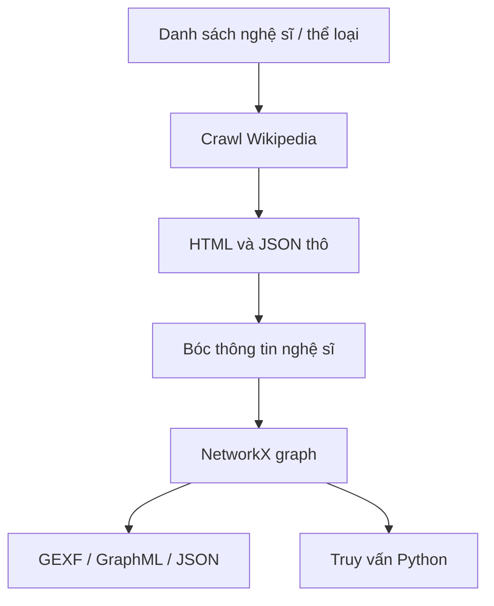

# Team 4 — Mạng nghệ sĩ âm nhạc Mỹ–Anh

## Kết luận nhanh

Repo này là một **pipeline thu thập dữ liệu và xây đồ thị**, chưa phải GraphRAG. Điểm mạnh nằm ở việc tách tương đối rõ các bước crawl Wikipedia → phân tích trang → dựng graph → chạy truy vấn. Không có LLM, embedding, vector database, huấn luyện model hay chatbot hỏi bằng ngôn ngữ tự nhiên.

- Repo: https://github.com/manhperas/graph_repo
- Nhánh/commit đã đọc: `dev` — `b6b6c7f558967a056153c0547fc5d5c5ee1d41df`
- Nguồn đối chiếu: `README.md`, toàn bộ `src/`, dữ liệu mẫu trong `data/`, và báo cáo Group 4.

## Kiến trúc dễ hiểu

Hệ thống gồm bốn khối:

1. **Crawler**: nhận tên nghệ sĩ/thể loại hoặc một nghệ sĩ gốc, tải trang Wikipedia.
2. **Analyzer**: bóc thông tin như thể loại, hãng đĩa và các liên kết sang nghệ sĩ khác.
3. **Graph builder**: biến dữ liệu đã bóc thành node và edge bằng NetworkX.
4. **Query utility**: chạy các truy vấn Python như đường đi ngắn nhất, nghệ sĩ theo thể loại, node kết nối nhiều nhất.



## Node và edge của graph

| Thành phần | Ý nghĩa | Ví dụ |
|---|---|---|
| Node `artist` | Một nghệ sĩ/ban nhạc | `Coldplay` |
| Node `genre` | Một thể loại nhạc | `Alternative rock` |
| Node `label` | Hãng đĩa | `Parlophone` |
| Edge `plays_genre` | Nghệ sĩ chơi thể loại nào | `Coldplay → Alternative rock` |
| Edge `signed_to` | Nghệ sĩ thuộc hãng nào | `Coldplay → Parlophone` |
| Edge `collaborates_with` | Liên kết được suy đoán là hợp tác | `Artist A — Artist B` |

Builder còn hỗ trợ các loại phụ như thành viên ban nhạc, nhà sản xuất, giải thưởng và bảng xếp hạng. Tuy nhiên một số dữ liệu phụ được điền từ hàm mẫu/fallback, nên không nên mặc nhiên xem toàn bộ là kết quả crawl thật.

Điểm cần lưu ý: `collaborates_with` được suy ra chủ yếu từ liên kết nội bộ Wikipedia và biểu thức chính quy. Một trang nhắc đến nghệ sĩ khác không có nghĩa hai người thật sự hợp tác; edge này có nguy cơ dương tính giả.

## Pipeline và kiểu dữ liệu vào/ra

| Bước | Input | Xử lý | Output |
|---|---|---|---|
| Chọn nguồn | `list[str]`, ví dụ `["Radiohead", "Coldplay"]`; hoặc `genre="rock"`; hoặc `seed="The Beatles", depth=2` | Tạo hàng đợi crawl | Danh sách tiêu đề trang |
| Crawl | Tên trang dạng `str` | Gọi Wikipedia API/tải HTML, giới hạn tốc độ và retry | Nội dung HTML dạng `str`, metadata JSON dạng `dict` |
| Phân tích | HTML/JSON thô | Đọc infobox, thể loại, hãng đĩa, liên kết | `dict[str, object]`; ví dụ `{"name":"Coldplay","genres":["Alternative rock"],"labels":["Parlophone"]}` |
| Dựng graph | Nhiều dictionary nghệ sĩ | Tạo node/edge trong `networkx.Graph` | Đồ thị vô hướng trong bộ nhớ |
| Xuất | Graph NetworkX | Serialize | `.gexf`, `.graphml`, `.json` |
| Truy vấn | Tên node dạng `str` | Duyệt graph | `dict` hoặc `list[dict]` |

Ví dụ dữ liệu thật trong repo: bản ghi `Coldplay` có trường `origin`, danh sách `genres` và danh sách `labels`. Với thể loại chính, code gán trọng số edge cao hơn thể loại phụ (`2` so với `1`).

## Từ câu hỏi đến câu trả lời

Repo **không có luồng user gõ câu tiếng Việt/Anh rồi nhận câu trả lời**. Luồng hiện tại là gọi hàm Python:

```python
result = query_system.find_shortest_path("The Beatles", "Taylor Swift")
```

Output có dạng:

```json
{
  "path_length": 3,
  "path": ["The Beatles", "...", "Taylor Swift"]
}
```

Các API truy vấn chính còn gồm:

- `get_artist_info(name)` → `{"artist_info": {...}, "connections": [...], "total_connections": 12}`.
- `get_artists_by_genre(genre)` → danh sách nghệ sĩ.
- `get_most_connected_artists()` → danh sách xếp hạng theo bậc node.
- `get_common_collaborators(a, b)` → các node lân cận chung.

Để trở thành GraphRAG, repo cần thêm: nhận câu hỏi tự nhiên → nhận diện nghệ sĩ/ý định → truy xuất graph → đóng gói bằng chứng → LLM chỉ diễn đạt từ bằng chứng đó. Hiện cả bốn bước này chưa có.

## AI, LLM và huấn luyện

- **LLM**: không có.
- **Embedding/vector retrieval**: không có.
- **Fine-tune/train model**: không có.
- **GraphRAG**: không có; chỉ có graph retrieval qua hàm Python.

## Vấn đề crawl và vận hành

- Cấu trúc HTML/infobox Wikipedia thay đổi có thể làm parser hỏng.
- Tên nghệ sĩ trùng nhau và redirect có thể tạo node trùng hoặc nối sai.
- Crawl theo liên kết dễ nở rất nhanh; `depth` và `max_artists` là hàng rào cần thiết.
- Quan hệ hợp tác đang dựa trên heuristic nên cần nguồn xác nhận hoặc trường `evidence_url`.
- README/báo cáo nói đến Neo4j và quy mô 5.924 node/38.934 edge, nhưng snapshot code được đọc không có importer/driver Neo4j tương ứng. Dữ liệu mẫu trong repo nhỏ hơn nhiều; vì vậy không thể dùng con số báo cáo để mô tả trạng thái chạy được của repo.

## Đánh giá

**52/100** theo thang ưu tiên khả năng tiến tới GraphRAG: crawl khá rõ, graph đủ dùng cho phân tích cơ bản, nhưng thiếu lớp hỏi–đáp, AI và kiểm chứng quan hệ. Repo phù hợp làm nền ETL/graph hơn là hệ thống RAG hoàn chỉnh.

## Bằng chứng code chính

- `src/wikipedia_crawler.py`, `src/crawl_artists.py`, `src/batch_download.py`: crawl.
- `src/wikipedia_analyzer.py`: bóc dữ liệu và suy đoán liên kết.
- `src/network_builder.py`: schema node/edge và xuất graph.
- `src/network_queries.py`: truy vấn và định dạng kết quả.
- `data/processed/analysis_results.json`: mẫu dữ liệu đã phân tích.

