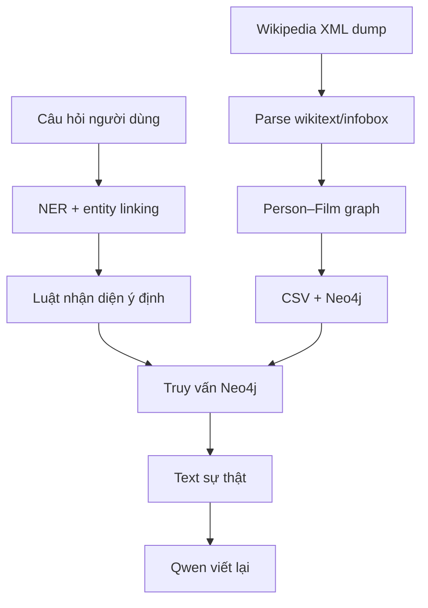

# Team 5 — GraphRAG diễn viên, đạo diễn và phim Việt Nam

## Kết luận nhanh

Đây là một GraphRAG **thiên về truy xuất graph có kiểm soát**: code nhận diện thực thể và ý định bằng luật/fuzzy matching, lấy sự thật từ Neo4j, sau đó Qwen chỉ viết lại câu trả lời. Thiết kế này dễ kiểm soát bịa đặt hơn việc giao cả truy vấn cho LLM, nhưng chưa có vector RAG và phần tiền xử lý còn nặng notebook.

- Repo: https://github.com/Nhungnguyen0804/vn-actors-directors-network
- Commit đã đọc: `7b7c7bc9e498e05c6970761fc1d17bacbe2cc0a6`
- Nguồn đối chiếu: code, notebook, artifact model/dữ liệu, `Nhóm 5.pdf`.

## Kiến trúc

Hệ thống có hai luồng độc lập:

- **Luồng offline**: Wikipedia dump → bóc người/phim → tạo quan hệ → CSV/NetworkX → Neo4j.
- **Luồng online**: câu hỏi → nhận diện tên → nối tên với node → xác định ý định → query Neo4j → Qwen viết lại → API trả JSON.



## Node và edge

| Thành phần | Ý nghĩa | Ví dụ |
|---|---|---|
| Node `Person` | Diễn viên/đạo diễn | `Trấn Thành` |
| Node `Film` | Phim | `Nhà bà Nữ` |
| Edge `ACTED_IN` | Người đóng phim | `Trấn Thành → Nhà bà Nữ` |
| Edge `DIRECTED` | Người đạo diễn phim | `Trấn Thành → Nhà bà Nữ` |
| Edge `COLLABORATED` | Hai người cùng làm phim | có `film_count`, `films`, `weight` |
| Edge mở rộng | Cùng trường, cùng nơi, vợ/chồng… | `SAME_SCHOOL`, `SAME_LOCATION` |

Ví dụ file `collab.csv` dùng các cột:

```text
source: str
target: str
film_count: int
films: chuỗi biểu diễn danh sách tên phim
collaboration_types: str
weight: float
```

Ví dụ thực tế là quan hệ Trấn Thành–Uyển Ân có số phim chung và loại cộng tác `director-actor`. Theo báo cáo, graph có 1.115 node và 13.056 edge; đây là số trong báo cáo, không phải phép đếm lại bằng một Neo4j đang chạy trong phiên phân tích.

## Pipeline dữ liệu offline

| Bước | Input | Xử lý | Output |
|---|---|---|---|
| Đọc Wikipedia | XML dump, từng page là text/wikitext | Stream để tránh nạp toàn bộ dump vào RAM | Iterator các page `{title, text}` |
| Phân loại | `title:str`, `infobox:dict` | Heuristic xác định Person hay Film | Bản ghi có `type` |
| Bóc quan hệ | Wikitext/infobox | Lấy diễn viên, đạo diễn, nhân vật, link liên quan | Danh sách tuple/dict quan hệ |
| Mở rộng | Seed người/phim | Đi theo liên kết phù hợp, lọc trang rác | Tập Person và Film đã chuẩn hóa |
| Dựng graph | Dictionary người/phim | Tạo graph hai phía Person–Film rồi suy ra Person–Person | NetworkX graph |
| Xuất/import | Graph | Chuyển thành CSV | `person.csv`, `film.csv`, `collab.csv`, sau đó Neo4j |

Điểm yếu dữ liệu: CSV node giữ rất nhiều cột infobox thô, nên schema rộng, nhiều ô trống và khó ổn định giữa các trang Wikipedia. Notebook lớn và có logic trùng lặp khiến việc chạy lại từ đầu khó hơn một pipeline CLI chuẩn.

## Luồng user query → answer, kèm kiểu dữ liệu

Ví dụ câu hỏi: **“Trấn Thành và Ninh Dương Lan Ngọc đóng chung phim nào?”**

1. API nhận `QuestionRequest`:

   ```json
   {"question":"Trấn Thành và Ninh Dương Lan Ngọc đóng chung phim nào?","debug":false,"use_finetuned":false}
   ```

2. NER nhận `str`, trả `list`, ví dụ `["Trấn Thành", "Ninh Dương Lan Ngọc"]`.
3. Entity linking dùng graph đã nạp và fuzzy matching, trả:

   ```json
   [
     {"node_name":"Trấn Thành","type":"person","score":100,"match_type":"exact_ordered"},
     {"node_name":"Ninh Dương Lan Ngọc","type":"person","score":100,"match_type":"exact_ordered"}
   ]
   ```

4. `classify_intent` dùng biểu thức chính quy, trả cặp `(intent_name, config)`, ở đây là `get_common_movies` và tên hàm query. Đây là logic luật, **không phải LLM hiểu ý định**.
5. `execute_query` gọi hàm Neo4j tương ứng. Output thường là `list[str]` tên phim hoặc `list[dict]` cho kết quả phức tạp.
6. `format_result` biến graph facts thành text cứng, ví dụ `PHIM CHUNG cua ...: Cua lại vợ bầu.`
7. `llm_paraphrase` đưa đúng câu hỏi + text sự thật cho Qwen, yêu cầu chỉ viết tự nhiên, không thêm dữ kiện.
8. FastAPI trả:

   ```json
   {
     "answer":"...",
     "progress":{"status":"done","elapsed_ms":1234,"estimated_total_ms":1200},
     "steps":[{"id":"extract_entities","type":"llm","input":"...","output":{}}]
   }
   ```

API ghi cả input/output từng bước nên khá thuận tiện để debug. Tuy nhiên bước NER bị gắn nhãn `llm` trong trace dù implementation chủ yếu là pipeline NLP/heuristic.

## GraphRAG và RAG component

| Thành phần | Có? | Cách làm |
|---|---:|---|
| Nhận diện thực thể | Có | Hàm NLP tự xây + từ điển/heuristic |
| Nối thực thể với graph | Có | Exact/token/fuzzy matching, có gợi ý loại Person/Film |
| Nhận diện ý định | Có | Regex theo mẫu câu |
| Truy xuất graph | Có | Hàm Cypher cố định hoặc chuỗi quan hệ 1–n hop |
| Vector retrieval | Không | Không có embedding/vector store trong luồng chatbot |
| Tạo câu trả lời | Có | Qwen viết lại text đã lấy từ graph |
| Dẫn nguồn | Không rõ | Câu trả lời không trả về node/edge/evidence URL cụ thể |

Nói ngắn gọn: đây là **Graph-only RAG**. “R” là query Neo4j; “G” là Qwen diễn đạt. Không có retrieval theo độ giống vector.

## Model AI và cách train

### Qwen dùng cho câu trả lời

- Base model: `Qwen/Qwen2.5-0.5B-Instruct`.
- Có thể gắn LoRA adapter trong `outputs_graphrag_lora`.
- Artifact xác nhận LoRA `r=16`, `alpha=16`, tác động vào các lớp q/k/v/o và gate/up/down; base là bản Qwen 0.5B nén 4-bit của Unsloth.
- Checkpoint cho thấy 60 bước, gần 2 epoch, batch size 2. Tuy nhiên repo **không chứa script/notebook tạo adapter Qwen**, nên không kiểm chứng được nguồn dữ liệu, prompt, cách chia tập hay lệnh train. Vì vậy model có bằng chứng đã train, nhưng quy trình chưa tái lập đầy đủ.
- API mặc định gọi `load_llm_model(fine_tune=False)`, tức **mặc định dùng base model, không dùng adapter**, dù request có trường `use_finetuned`. Đây là lỗi nối dây quan trọng.

### SetFit dùng cho trích xuất quan hệ

`src/nlp/train_setfit.py` tạo câu mẫu từ triple `{subject, relation, object}`, chia train/test 80/20 có stratify, dùng `paraphrase-multilingual-MiniLM-L12-v2`, train classifier 5 epoch, batch 16 và tắt contrastive learning (`num_iterations=0`). Output là thư mục model `data/my_fast_re_model`.

Rủi ro: khi một nhãn thiếu mẫu, code sinh bản cân bằng bằng cách biến đổi chuỗi kiểu `_AUG`; dữ liệu giả như vậy có thể làm classifier học dấu hiệu nhân tạo thay vì ngữ nghĩa thật.

## Rủi ro kỹ thuật

- `app` nếu chạy nhầm ở root chỉ là Gradio echo demo; backend thật là `src/api.py`.
- `use_finetuned` từ request chưa thực sự điều khiển model được load.
- Bộ lọc “chống bịa” chặn nếu response chứa các từ rất phổ biến như “năm”, “đạo diễn”, “tại”; nó có thể loại cả câu đúng.
- Model và graph được giữ global; cần kiểm soát đồng thời khi nhiều request đến.
- CORS cho phép mọi origin trong khi bật credentials.
- Thiếu test end-to-end và một lệnh duy nhất để build lại graph.

## Đánh giá

**77/100**. Có luồng GraphRAG thật, output từng bước minh bạch và tránh cho LLM tự viết Cypher. Điểm trừ chính là không có vector retrieval, pipeline train Qwen không tái lập được, request fine-tuned chưa nối đúng, và ETL còn rời rạc.

## Bằng chứng code chính

- `build_graph.ipynb`, `extract_viwiki.ipynb`: ETL Wikipedia.
- `src/api.py`: contract API và trace input/output.
- `src/model_v2.py`: intent → query → formatter → Qwen.
- `src/chatbot/entity_linking_node.py`, `src/intent_pattern.py`, `src/chatbot/graph_query.py`.
- `src/nlp/train_setfit.py`: train SetFit.
- `outputs_graphrag_lora/adapter_config.json`, `checkpoint-60/trainer_state.json`: bằng chứng LoRA.

